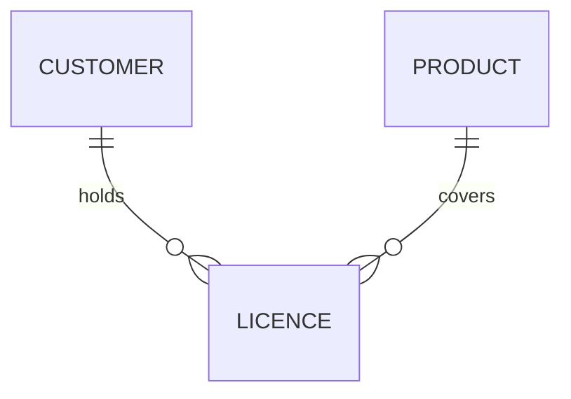

# Customers, products and licences

The question is: **did each customer's product entitlement arrive in Salesforce accurately?** These are fictional software entitlements, not Gallagher's products or licensing rules.

The model, sample CSVs and SQL preparation have passed a live Databricks run. `--load` builds and tests all three snapshots but saves only customer Accounts. Salesforce configuration and loading for products and licences remain pending.

## Relationships



Each licence belongs to exactly one customer and one product. Customers need not have licences. A subsidiary's licence belongs to that subsidiary; its parent does not inherit the seats.

## Source data

| File | One row represents | Fields |
| --- | --- | --- |
| [customers_v1.csv](../p0_data/seed/customers_v1.csv) | One customer | Existing customer fields; IDs stay unchanged |
| [products_v1.csv](../p0_data/seed/products_v1.csv) | One software product | `product_id`, `product_code`, `product_name`, `is_active` |
| [licences_v1.csv](../p0_data/seed/licences_v1.csv) | One grant for one term | `licence_id`, `customer_id`, `product_id`, `seats`, `starts_on`, `ends_before`, `cancelled_on` |

Product and licence IDs are stable UUIDv7 strings. Codes and names are readable labels, not relationship keys. Product codes must be unique; every customer/product reference must resolve to exactly one source row. IDs must be non-empty and unique within their table.

For Databricks uploads, use `STRING` for IDs, codes and names; `BOOLEAN` for `is_active`; `BIGINT` for seats; and `DATE` for the three licence dates. An empty `cancelled_on` means null. Seats must be a positive whole number, limited to nine digits for the proposed destination field.

## Dates and seat allowances

Dates are business dates in New Zealand, without times. Start is inclusive; `ends_before` is the first day without access. Start must precede end. A cancellation, when present, must fall on or after start and before end. Cancellation on the start date means the licence never becomes active.

On a chosen date, a licence is active when:

```text
starts_on <= date < ends_before
and (cancelled_on is empty or date < cancelled_on)
```

Derive status for that date in this order: cancelled, expired, scheduled, otherwise active. Do not store an `active` flag that goes stale overnight. Customer CRM status and product availability do not override the licence dates.

A renewal gets a new ID and retains the old term. In the sample, the new term starts exactly when the old term ends. Separate overlapping grants add seats; duplicate IDs are errors. Seats do not change within a term in this model. Amendments and cancellation reversals are outside this version's scope.

The 12 licences include renewal, additional seats, multiple products, future starts, cancellation, start/end boundaries and an active licence for an inactive product. On **26 November 2026**, six are active, representing 117 product seats. This is not a count of distinct people.

## SQL preparation

[stage_products.sql](../p1_preparation/dbt/models/stage_products.sql) trims codes and names, turns empty labels into nulls and retains inactive products. [stage_licences.sql](../p1_preparation/dbt/models/stage_licences.sql) copies every term unchanged. Neither changes IDs or discards invalid records.

Tests cover missing values, duplicate IDs/codes, blank IDs, source types, seat bounds and date ranges. Relationship tests check licence customer/product IDs against the selected snapshots; parent uniqueness tests ensure a reference cannot match several rows. Cancellation on the start date is valid; cancellation on or after expiry is not.

Upload `products_v1.csv` and `licences_v1.csv` to the customer source's catalog and schema, using the types above and those filenames as table names. `prepare_migration()` builds and tests all three snapshots with one run suffix, then returns their full names in `MigrationTables`. A customer load records all three names in its report. Any failed dbt check prevents Salesforce access. These are separate source reads, not a single transaction across the three source tables.

dbt uses [cautious test selection](https://docs.getdbt.com/reference/node-selection/test-selection-examples): a relationship check runs only when both of its models are selected. The load selects all three models, so both licence relationship checks are included. All six SQL unit tests and 24 data checks passed on Databricks, including the two relationship checks, with no warnings, errors or skips.

## Proposed Salesforce destination

Keep customers as `Account`. Use the standard [Product2 fields](https://developer.salesforce.com/docs/platform/field-reference/references/field-reference/salesforce-field-reference-product2.html) for the catalogue, and a custom `Licence__c` object for terms. Salesforce supports [custom-object lookups to both Account and Product2](https://developer.salesforce.com/docs/platform/object-reference/guide/sforce-api-objects-custom-objects.html).

| Source | Destination | Type |
| --- | --- | --- |
| Product `product_id` | `Product2.Source_Product_ID__c` | Text (36), Unique, External ID |
| `product_code` / `product_name` / `is_active` | `ProductCode` / `Name` / `IsActive` | Standard fields |
| `licence_id` | `Licence__c.Source_Licence_ID__c` | Text (36), Unique, External ID |
| `customer_id` | `Licence__c.Customer__c` | Required lookup to Account |
| `product_id` | `Licence__c.Product__c` | Required lookup to Product2 |
| `seats` | `Licence__c.Seats__c` | Required Number (9, 0) |
| `starts_on` | `Licence__c.Starts_On__c` | Required Date |
| `ends_before` | `Licence__c.Ends_Before__c` | Required Date |
| `cancelled_on` | `Licence__c.Cancelled_On__c` | Optional Date |

Use an auto-number Name for `Licence__c`. Require both lookups and prevent parent deletion while referenced. Load and verify customers and products first, then resolve their source IDs to Salesforce record IDs for the licence lookups. Do not create placeholder parents or discard unmatched licences. Migrate historical and future licences too, not just active ones. Verify parent links as well as dates and seats.

This is the proposed contract, not a claim that these custom fields already exist or that the integration has been tested live.

## Dimensional modelling stretch goal

Ask: **how many seats were licensed to each customer for each product at each month end?** Use customer, product and date dimensions, with one fact row per licence per reporting month. Its measure is the seat allowance when active on that month-end date, otherwise zero.

For the sample, all-product totals are 117 on 30 November 2026 and 107 on 31 December 2026. Keep customer/product grouping in the actual report. These are entitlements, not revenue, actual usage or a history of changes absent from the source. Build this after the operational licence migration works.
